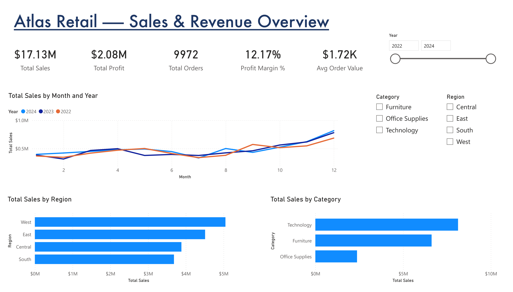
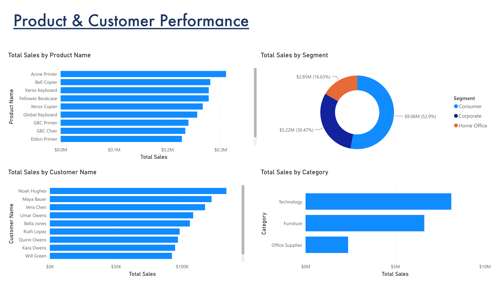
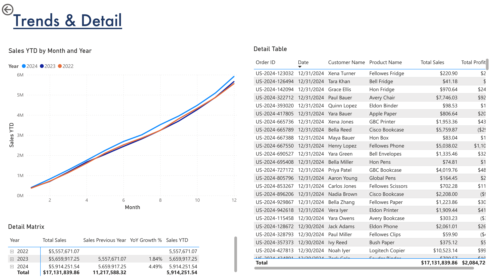

# Atlas Retail — Sales & Revenue Analytics Dashboard

**Power BI · SQL · star-schema modeling · DAX** — an end-to-end BI case study on a synthetic Superstore-style retail dataset (9,994 order lines, 2022–2024).

> **Business question:** *Where does Atlas Retail make and lose money — and what should it do about it?*

---

## What this shows (Page 1 — Executive Overview)
- **KPI cards:** Total Sales $17.1M · Total Profit $2.08M · Profit Margin 12.2% · Orders 9,972 · Avg Order Value $1.72K
- **Revenue trend** by month, overlaid by year (2022 → 2024) — seasonality + growth at a glance
- **Sales by Region** and **Sales by Category** breakdowns
- **Slicers:** Year · Category · Region (fully cross-filtering)

## Page 2 — Product & Customer Performance

- **Top 10 Products** and **Top 10 Customers** by revenue (`Top N` filters)
- **Sales by Segment** (Consumer 53% · Corporate 31% · Home Office 17%)
- **Category → Sub-Category drill-down** (interactive)

## How it was built (the stack)
1. **SQL (SQLite) — data prep.** Built a **star schema** from a flat orders table: `fact_sales` (9,994) + `dim_customer` + `dim_product` + `dim_calendar`. Explored with `SELECT`/`WHERE`/`GROUP BY`/**JOINs**/**CTEs**/**window functions**; verified referential integrity before modeling.
2. **Model — star schema in Power BI / Fabric.** `fact_sales` (many) → each dimension (one), single-direction filters.
3. **DAX measures** (in a dedicated `_Key_Measures` table): `Total Sales`, `Total Profit`, `Profit Margin %` (`DIVIDE`), `Total Orders` (`DISTINCTCOUNT`), `Avg Order Value`. *(Time-intelligence + RANKX measures on Pages 2–3.)*
4. **Report** — KPI row, YoY trend, region/category bars, slicers.

## 3 insights I found
1. **Technology carries the company** — $1.26M profit, more than Office Supplies and Furniture *combined*.
2. **Furniture is a volume trap** — 2nd-highest sales ($6.6M) but the *lowest* profit ($386k): a **5.8% margin** vs 15–19% elsewhere. The 10 worst-losing orders are **all deep-discounted (40%)**, and **9 of the 10 are furniture** — a thin margin can't survive a deep discount.
3. **Strong Q4 seasonality + real growth** — every year peaks into December then resets in January; 2024 runs above 2023 above 2022.

## Recommendation
**Cap discounts on Furniture** (losses cluster at the 40% tier), protect Technology's momentum, and plan inventory/marketing around the Q4 peak.

## Tech
Power BI (Fabric) · DAX · star-schema modeling · SQL (JOINs/CTEs/window functions) · KPI/dashboard design.

## Use it as a template
- **[Connect your data](docs/CONNECT_YOUR_DATA.md)** — the exact schema your data needs + the swap steps.
- **[Customization guide](docs/CUSTOMIZATION.md)** — re-brand, add measures/visuals.

## Files
- `sql/` — the SQL build (01_explore → 05_dashboard), fully commented
- `powerbi/DAX_measures.md` — every measure + why
- `retail.db` — the SQLite star schema · `powerbi_csv/` — CSV extract loaded into Power BI

## Page 3 — Trends & Detail

- **Time-intelligence matrix** — Total Sales · Sales Previous Year · **YoY Growth %** · **Sales YTD** by year/month
- **Sales YTD line** (cumulative ramp, per year) · **order-level detail table**
- **Drill-through**: right-click any category/region on Pages 1–2 → jump here, auto-filtered

**Advanced DAX shown:** `SAMEPERIODLASTYEAR`, `TOTALYTD`, and a `HASONEVALUE` **total-guard** (so YoY blanks at the grand total instead of showing a misleading figure).

**Possible extensions:** a parameterized data-swap (drop any retail dataset into the star-schema template) and a custom visual theme.
